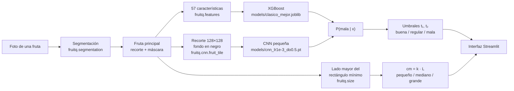

# Arquitectura del sistema

## 1. Flujo de inferencia

La rama de XGBoost es el modelo principal: tiene el mejor F1-macro en test (0.964). La CNN se conserva como modelo de deep learning comparado; para la clase `regular`, sus probabilidades más suaves no superaron a XGBoost en la validación con recortes (fase 4).

Estado de los bloques:
- **Implementados:** segmentación, características, XGBoost y CNN, con la tarea binaria buena/mala; los umbrales de 3 clases sobre la probabilidad de XGBoost (`fruitq.quality`, `models/umbrales.json`); y la estimación de tamaño en centímetros (sección 5).
- **Pendientes:** la interfaz. Además, el clasificador no generaliza a las fotos propias (`docs/fases/05_evaluacion.md`); la aplicación debe advertirlo.

## 2. Segmentación (`src/fruitq/segmentation.py`)

| Paso | Método | Motivo |
|---|---|---|
| Modelo del fondo | k-means (k = 3) en CIELab sobre un anillo en el borde de la imagen | Los fondos de Kaggle no son uniformes (pasto, mesas, telas) |
| Distancia al fondo | $D(x) = \min_j \lVert \mathrm{Lab}(x) - c_j \rVert$ | Un píxel es fruta si su color está lejos de todos los colores del fondo |
| Máscara gruesa | Umbral de Otsu sobre $D$ | Umbral automático, sin parámetros por imagen |
| Refinamiento | GrabCut restringido a una banda alrededor de la máscara | Mejora los bordes sin unir frutas vecinas |
| Separación de frutas que se tocan | Watershed sobre la transformada de distancia (`skimage`) | Imágenes de `mixed_quality` con varias frutas en contacto |
| Filtros | Área mínima, solidez ≥ 0.6, fracción de borde ≤ 0.25 | Descarta sombras, fondo y frutas cortadas por el borde |
| Huecos | Se rellenan solo si son pequeños o su color es lejano al fondo | Conserva la forma de frutas con brillos |

## 3. Características manuales (`src/fruitq/features.py`)

| Grupo | Cantidad | Detalle |
|---|---|---|
| Histograma HSV | 32 | H: 16 bins, S: 8, V: 8, solo sobre la fruta |
| Momentos de color | 18 | Media, desviación y asimetría por canal en HSV y en Lab |
| Forma | 3 | Circularidad $4\pi A/P^2$, solidez, relación de aspecto |
| Nitidez y textura | 2 | Varianza del Laplaciano, energía del gradiente (Sobel) |
| Indicadores de defecto | 2 | Fracción de píxeles oscuros y fracción de píxeles de baja saturación |
| **Total** | **57** | |

## 4. Modelos

### 4.1 XGBoost (modelo principal)

- `Pipeline(StandardScaler, XGBClassifier)`, con 400 árboles, `max_depth = 7`, `learning_rate = 0.1` y `colsample_bytree = 0.8`.
- Hiperparámetros elegidos con `GridSearchCV` y `StratifiedGroupKFold(k = 5)`. Los grupos de casi duplicados nunca se reparten entre pliegues.
- Pesos de muestra $w_i = N / (K\,N_{e(i)})$ por estrato fruta×calidad para compensar el desbalanceo.

### 4.2 CNN pequeña desde cero (`src/fruitq/cnn.py`)

| Capa | Salida | Parámetros |
|---|---|---|
| Entrada (RGB, fondo en negro) | 3 × 128 × 128 | — |
| Bloque 1: [Conv 3×3 → BN → ReLU] × 2 → MaxPool 2×2 | 16 × 64 × 64 | 2 800 |
| Bloque 2: [Conv 3×3 → BN → ReLU] × 2 → MaxPool 2×2 | 32 × 32 × 32 | 13 952 |
| Bloque 3: [Conv 3×3 → BN → ReLU] × 2 → MaxPool 2×2 | 64 × 16 × 16 | 55 552 |
| Global Average Pooling | 64 | — |
| Dropout (0.5) → Lineal | 2 | 130 |
| **Total** | | **72 434** |

Entrenamiento:
- AdamW con `lr = 1e-3` y `weight_decay = 1e-4`, más decaimiento coseno de la tasa de aprendizaje.
- 20 épocas de 6 000 muestras balanceadas por estrato.
- Aumento de datos: las 8 simetrías del cuadrado más brillo y contraste de ±20 %. El tono y la saturación no se alteran.
- Se guarda el modelo con el mejor F1-macro en validación.

## 5. Tamaño (`src/fruitq/size.py`)

- **Kaggle** (distancia de cámara no controlada): diámetro equivalente $d = 2\sqrt{A/\pi}$, normalizado por el lado menor de la imagen, $d / \min(H, W)$. Solo es comparable entre fotos tomadas a la misma distancia.
- **Fotos propias** (cámara a 30 cm): $L_{px}$ es el lado mayor del rectángulo de área mínima que contiene la máscara (`cv2.minAreaRect`), con la imagen reducida a 1024 px por el lado mayor. Corresponde a la medida con regla: diámetro mayor en manzana y guayaba, largo de punta a punta en banano.
- **Longitud en centímetros:** $L_{cm} = k \cdot L_{px}$, con $k = \operatorname{mediana}(\text{medida}_{cm} / L_{px}) = 0.0404$ cm/px, validado dejando una fruta fuera. Error absoluto medio: 0.98 cm.
- **Clase de tamaño:** terciles de la medida en cm, calculados por tipo de fruta.
- **Parámetros:** `models/umbrales.json`, sección `tamano`. Resultados en `docs/fases/05_evaluacion.md`.

## 6. Tiempos de inferencia (CPU, 4 núcleos)

| Etapa | Tiempo por imagen |
|---|---|
| Segmentación y extracción de características | ~270 ms |
| XGBoost | < 0.1 ms |
| CNN (en lote) | ~5 ms |

La segmentación domina el tiempo total. Aun así, el sistema procesa unas 3 imágenes por segundo, suficiente para la interfaz con cámara.

## 7. Organización del código

| Módulo | Responsabilidad |
|---|---|
| `src/fruitq/config.py` | Rutas, clases y semilla |
| `src/fruitq/io.py` | Lectura y escritura de imágenes (rutas con tildes en Windows) |
| `src/fruitq/segmentation.py` | Segmentación de frutas |
| `src/fruitq/features.py` | Características manuales |
| `src/fruitq/size.py` | Estimación de tamaño |
| `src/fruitq/data.py` | Firmas de imagen, agrupación de casi duplicados y partición sin fuga |
| `src/fruitq/cnn.py` | Preprocesamiento y arquitectura de la CNN |
| `scripts/` | Puntos de entrada del flujo de datos y del entrenamiento |
| `app/` | Interfaces Streamlit |
